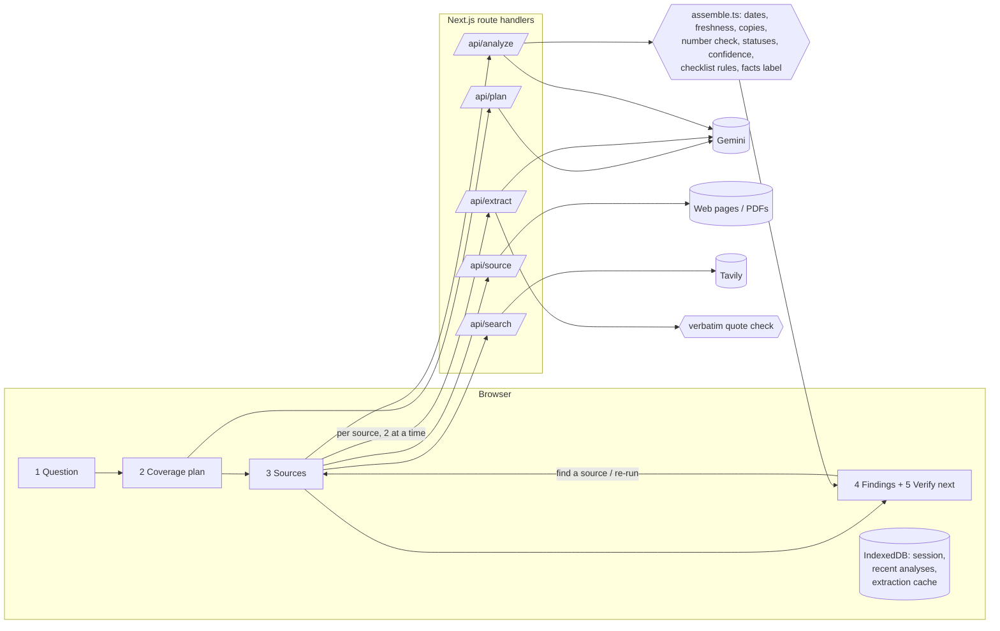

# GapMap

**Find out what your sources don't tell you.**

GapMap reads several sources about a question and maps what they **cover**, where they **disagree**, what may be **out of date** and what **none of them answer**. Every finding links to the exact sentence it came from, AI-written text is always labelled, and the result ends with a prioritised checklist of what to verify next.

It is not a chatbot and it does not give verdicts. It shows the shape of the evidence so you can decide what to trust.


| A conflict the AI missed, caught by the number check | Evidence viewer | Verify-next checklist |
|---|---|---|
|  |  |  |

---

## Try it in one minute (no keys needed)

1. `npm install && npm run dev`, open http://localhost:3000
2. Click **Sample demo** → pick a scenario → **Plan what to check** → **Continue to sources** → **Analyse**
3. Click **Take the 1-minute tour** beside the results
4. Open topic 5 (*Potential gap*) → **Find a source for this topic** → add the newer sample source → **Re-run** — the map shows what changed

Sample sources are fictional and clearly labelled. The AI steps replay saved outputs; everything else (quote checks, dates, copy and number checks, statuses, confidence, checklist rules) is computed live, so you can remove sources and re-run to see the findings change.

## The problem

When people research anything that matters — a scheme, a fee, a rule, an advisory, a health claim — they open several tabs and run into the same trouble:

- **Sources disagree**, and it's not clear whether one is wrong or simply older.
- **Pages go stale.** Old rates, deadlines and rules keep circulating long after they change, often undated.
- **Copies look like confirmation.** Five sites saying the same thing may all trace back to one original.
- **Gaps are invisible.** You notice what sources say, not what none of them mention — like a renewal rule or a deadline.
- **AI answers sound certain.** Chatbots summarise confidently and their citations don't always support the claim.

Search engines return links, and chatbots return one confident answer. Neither shows what's missing, what conflicts, or what to check next.

## How it works — five visible steps

1. **Question.** A topic, question or research goal.
2. **Coverage plan.** *Before reading any source*, GapMap lists what a complete answer should cover — each topic with how important it is and how fast that kind of information changes. You can edit it. (Labelled *AI suggestion*.)
3. **Sources.** Add links (pages or PDFs), search the web, paste text, upload a PDF, or paste a chatbot's answer to audit it. GapMap extracts readable text, finds each page's publish/update date (and shows where it found it), and guesses the source type — both can be corrected by hand.
4. **Findings.**
   - **Knowledge map** — one branch per planned topic, marked *Covered*, *Single source*, *Possibly outdated*, *Possible conflict* or *Potential gap* (colour **and** pattern, so it works without colour). Each branch explains *why this status* and *why this confidence*, pulls out what the newest official source says, and lists every quote.
   - **Information Facts label** — a nutrition-label summary: quotes found word-for-word vs not found, AI-written notes, independent origins, freshness, conflicts between sources, AI-answer contradictions, gaps and coverage. Every number jumps to its findings.
   - **Findings tabs** — gaps & single-source topics, conflicts (between sources / AI answer vs sources), dates & freshness with a source timeline, unanswered questions, and each source's extraction status.
   - **Evidence viewer** — the source text with the quote highlighted, a link that opens the original page *at that quote*, and, for a quote that wasn't found, the closest passage outlined as "not a match".
5. **Verify next.** A prioritised checklist (critical / important / good to check) with where to verify, a suggested search, a drafted message to the responsible organisation, notes, and **Add a source and re-run** to close the loop. Export as Markdown, PDF (print) or JSON.

## What makes it different

| Feature | What it does | Why it matters |
|---|---|---|
| **Coverage-based gap detection** | Plans what a complete answer needs *before* reading sources, then checks each part | Finds what's missing, not just what's said |
| **Verbatim quote check** | Every AI-extracted claim must match text on the page (exactly, or with only punctuation differences); otherwise it's *Uncertain* and excluded from evidence | Catches hallucinated citations; everything stays traceable |
| **Number check** | Rules compare figures in quotes (%, ₹, minutes, days, years…) across sources on the same topic | Catches conflicts the AI misses — see the Riverton sample |
| **Disagreement explainer** | Each conflict gets a likely reason (different dates, scope, definitions, genuine) and what would settle it; the newest source is marked | Many "conflicts" are just old vs new information |
| **Freshness by topic speed** | Compares each source's date with how fast its topics change; flags undated pages and ended cycles like "2024-25"; shows a timeline | Outdated details are caught automatically |
| **Source independence** | Detects copied text between sources (5-word shingles) and counts copies as one origin | Five copies aren't five confirmations |
| **AI answer audit** | A pasted chatbot answer is checked against the real sources and never counted as evidence | Directly addresses over-trust in AI summaries |
| **Computed status and confidence** | Status and confidence come from fixed rules over quotes, origins, source types and dates — each with plain-language reasons | The AI can't talk a topic into "covered" |
| **Close the loop** | From a gap or checklist item, find a source, re-run, and see *what changed* (unchanged sources aren't re-sent to the AI) | Verification is a loop, not a report |
| **Three labels everywhere** | *Sourced*, *AI suggestion*, *Uncertain* — on every claim, summary and finding | You always know what's evidence and what's a signal |

## Accuracy and transparency

| Shown in the app | Who produces it | How it's checked |
|---|---|---|
| Coverage plan | AI | Editable by you; labelled *AI suggestion* |
| Claims and quotes | AI | Every quote is matched against the full page text; failures are shown struck through and not counted |
| Dates, cycles, source type | Code | Shown with where the date was found; correctable by you (marked "set by you") |
| Copies / independent origins | Code | 5-word shingle overlap with size-aware thresholds |
| Number conflicts | Code | Same topic, same unit, different value, different origin |
| AI-proposed conflicts | AI | Kept only if they cite real claims from at least two sources |
| Topic status and confidence | Code | Fixed rules; each topic lists its reasons |
| Summaries, explanations, checklist | AI | Labelled *AI suggestion*; rules add checklist items for every gap, conflict, stale or critical single-source topic |

Other safeguards: the prompts forbid verdicts and outside knowledge; source text is passed as data with a prompt-injection guard; AI replies are validated field by field (bad items are dropped, not crashed on); a pasted AI answer has no date and is never evidence; sample sources are fictional and use `.example` addresses.

## Architecture



Each request is small (one source per extraction call), which keeps it inside free-tier rate limits and serverless time limits. Long sources are cut to their most relevant excerpts for the AI, but quotes are always checked against the full text.

## Run it locally

**Requirements:** Node.js 20.9 or newer.

```bash
git clone <your-repo-url> gapmap
cd gapmap
npm install
cp .env.example .env.local     # add a key (see below) — or skip and use the sample demo
npm run dev
```

Open http://localhost:3000. The header shows **AI connected** when a key is found.

### Keys and settings (all free)

| Variable | Needed for | Notes |
|---|---|---|
| `GEMINI_API_KEY` | Live analysis | Google AI Studio → *Get API key* (https://aistudio.google.com/apikey) |
| `TAVILY_API_KEY` | Optional "Search the web" tab | https://app.tavily.com — without it, add links by hand |
| `GEMINI_MODEL` | Optional | Force a model; otherwise GapMap falls back through current Flash models and asks the API which ones your key can use |
| `OPENAI_COMPAT_BASE_URL`, `_API_KEY`, `_MODEL` | Optional alternative to Gemini | e.g. Groq: `https://api.groq.com/openai/v1` |
| `RESPECT_ROBOTS` | Optional | `on` by default; GapMap won't read pages a site's robots.txt disallows |
| `RATE_LIMIT` | Optional | Per-connection limits that protect the free quotas on a public link; `off` to disable |
| `NEXT_PUBLIC_SITE_URL` | Optional | Public address, for link previews |

Restart `npm run dev` after editing `.env.local`.

### Tests and checks

```bash
npm test            # 69 unit + pipeline tests (vitest), no network needed
npm run check       # lint + typecheck + tests
npm run build && npm start
```

The pipeline test runs `/api/plan → /api/source → /api/extract → /api/analyze` with a fake AI that misbehaves on purpose (a retired model name, an invented quote, junk items). To click through **live mode** without keys, run the offline mock and point the app at it:

```bash
node scripts/mock-ai.mjs &
GEMINI_API_KEY=mock GEMINI_API_BASE=http://localhost:3999/v1beta \
TAVILY_API_KEY=mock TAVILY_API_BASE=http://localhost:3999 npm run dev
```

### Deploy

Deploys to Vercel's free tier as-is (`vercel.json` pins the Mumbai region): import the repo, add `GEMINI_API_KEY` (and optionally `TAVILY_API_KEY`) as environment variables, deploy. GitHub Actions runs lint, typecheck, tests and a build on every push.

## Sample scenarios

**Student concession pass** — *"What should I verify before applying for the Ambarpur Metro student concession pass?"* (fictional)

- a fare concession that dropped from 50% to 40%, explained as *likely different dates*
- an undated blog that copies a 2024 news report, so the two count as one origin
- a document requirement where the official FAQ and a student forum disagree
- an application deadline no source states — a *potential gap* you can close with a newer notice
- an extracted quote that isn't on the page, downgraded to *Uncertain*
- a pasted chatbot answer contradicted by newer official sources

**City water advisory** — *"Is the boil-water advisory in Riverton still in force, and what should residents do?"* (fictional)

- an official update vs an older news report on whether the advisory still applies
- a tips blog that says to boil for 10 minutes while official sources say 1 minute — **the saved AI output misses it; the number check catches it**
- a forwarded message with no date or origin
- a missing test-results topic you can fill with the sample's lab report

**Live mode** — enter any question and add 3–6 real sources of different types (official page, news, blog, forum). Questions about fees, eligibility, deadlines or rules that changed recently work especially well.

## Security and privacy

- Your work is saved in your own browser (IndexedDB) — nothing is stored on the server.
- Page fetching blocks private and local network addresses (every DNS answer and every redirect is checked), limits size and content types, and respects robots.txt.
- Request bodies are validated with limits; API routes are rate-limited per connection.
- Security headers: Content-Security-Policy, `X-Frame-Options: DENY`, `nosniff`, a strict referrer policy.

## Project structure

```
src/
  app/
    page.tsx · layout.tsx · error.tsx · opengraph-image.tsx
    api/                    plan · source · search · extract · analyze · health
  components/
    workspace/              the five-step workflow: session storage, header, steps, results, tour
    KnowledgeMap.tsx        map overview + topic branches
    FactsLabel.tsx          Information Facts label
    Findings.tsx            gaps · conflicts · dates · questions · sources
    Timeline.tsx            source dates against freshness limits
    Checklist.tsx           verify-next checklist, notes, export
    EvidenceViewer.tsx      source text with the quote highlighted
  lib/
    assemble.ts             deterministic analysis layer (statuses, confidence, checklist rules, label)
    quotes.ts               verbatim quote verification + closest passage
    numbers.ts              number check across sources
    dates.ts                date and cycle detection
    independence.ts         copied-source detection
    diff.ts                 what changed between runs
    samples/                two fictional scenarios with saved AI outputs
    server/                 AI client, prompts, page fetching, search, rate limits
tests/                      vitest suites
scripts/mock-ai.mjs         offline stand-in for Gemini and Tavily
```

## Limitations and future scope

- **Limits today:** sites that need a login or heavy JavaScript can't be read directly (search results fall back to the search service's copy; otherwise paste the text); scanned PDFs need OCR; the number check compares figures, not meaning; quality depends on the sources added.
- **Future:**
  - watch mode that re-checks saved questions on a schedule and alerts on changes
  - Hindi and other Indian-language sources (prompts already answer in the question's language)
  - OCR for scanned notices
  - shared checklists for classmates or teams
  - a browser extension that flags disputed claims on the page you're reading
  - domain templates (scholarships, schemes, admissions, visas) with expert-curated coverage plans

## Credits

Built by **Arush Giri** (rush) · ﹏𓊝﹏

Fonts: Archivo and Newsreader (SIL Open Font License, via Fontsource); a two-glyph subset of Noto Sans for the signature (SIL OFL, see `public/fonts/OFL-Noto.txt`). Icons: Lucide (ISC).

Licensed under the MIT License.
