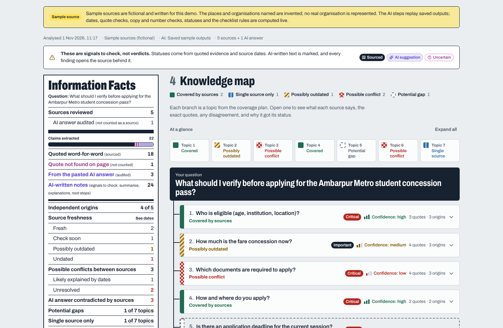
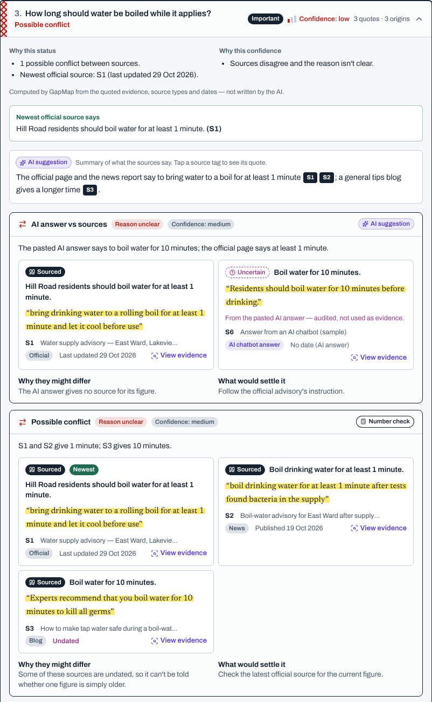
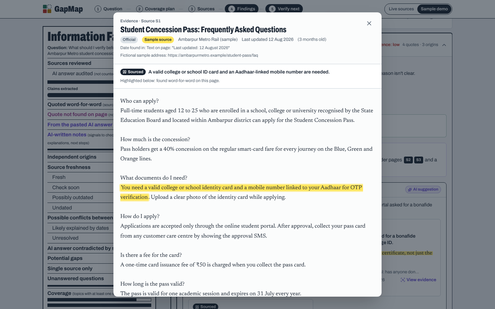
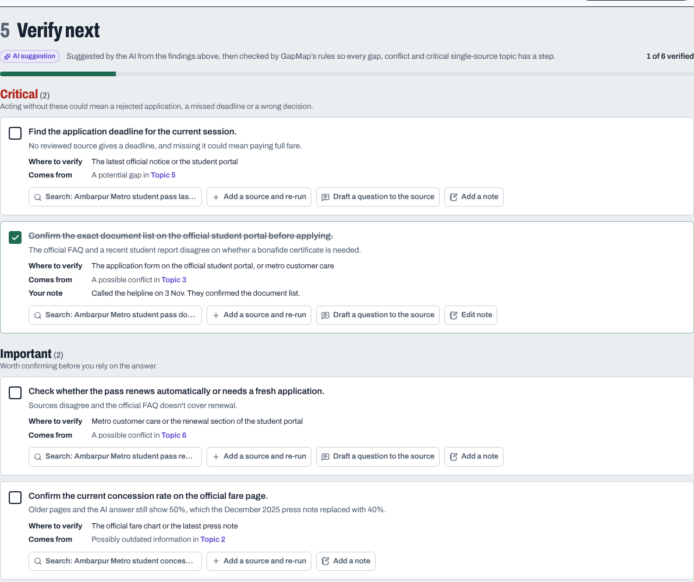
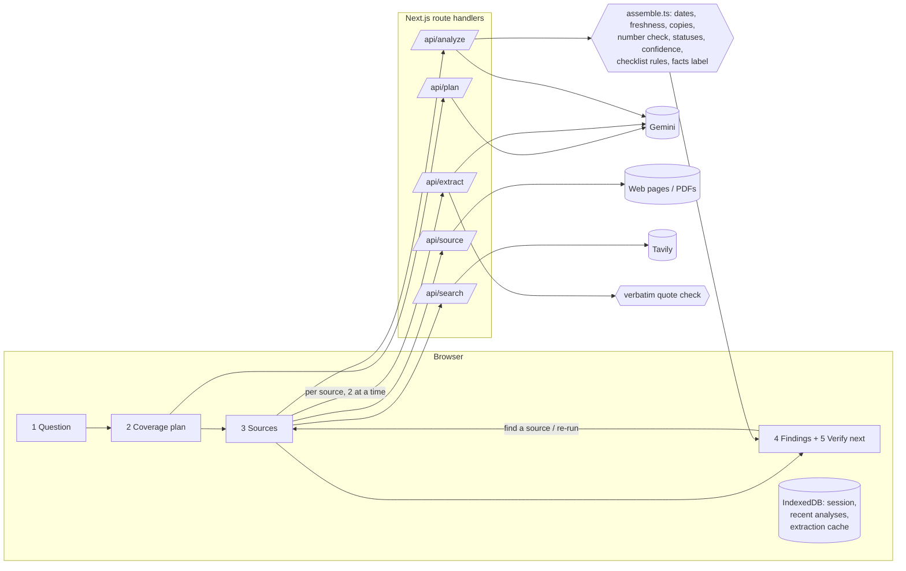

# GapMap

**Find out what your sources don't tell you.**

**Live site:** https://gapmap-eosin.vercel.app

GapMap reads several sources about a question and maps what they **cover**, where they **disagree**, what may be **out of date** and what **none of them answer**. Every finding links to the exact sentence it came from, anything the AI wrote is labelled, and the analysis ends with a prioritised checklist of what to verify next.

GapMap doesn't answer the question for you, and it never says whether something is true. It shows what the evidence looks like so you can decide what to trust.



| A conflict the AI missed, caught by the number check | Evidence viewer | Verify-next checklist |
|---|---|---|
|  |  |  |

## Try it in one minute (no keys needed)

Open the live site at https://gapmap-eosin.vercel.app, or run it on your own machine:

```bash
npm install
npm run dev
```

and open http://localhost:3000. Then:

1. Click **Sample demo**, pick a scenario, then **Plan what to check**, **Continue to sources** and **Analyse**.
2. Click **Take the 1-minute tour** next to the results.
3. Open topic 5 (*Potential gap*) and click **Find a source for this topic**. Add the newer sample source and re-run. The map shows what changed.

The sample sources are fictional and labelled as such on every screen. The AI steps replay saved outputs, but everything else (quote checks, dates, copy and number checks, statuses, confidence, checklist rules) runs live. Remove a source and re-run, and the findings change.

On the live site, **Live sources** works too: it searches the web, reads real pages and runs the AI on them. It uses free API tiers, so a full analysis of five sources takes a minute or two.

## The problem

When people look up something that matters, like a scheme, a fee, an exam rule or a health claim, they open several tabs and run into the same trouble:

- **Sources disagree**, and it's not clear whether one is wrong or simply older.
- **Pages go stale.** Old rates, deadlines and rules keep circulating long after they change, often with no date on the page.
- **Copies look like confirmation.** Five sites saying the same thing may all trace back to one original.
- **Gaps are invisible.** You notice what sources say, never what none of them mention, such as a renewal rule or an application deadline.
- **AI answers sound certain.** Chatbots summarise confidently, and their citations don't always support the claim.

Search engines return links and chatbots return one confident answer. Neither shows what's missing, what conflicts or what to check next. The cost is real: in 2023, Class 10 students in Maharashtra missed a board exam after trusting a fake timetable that went viral (Hindustan Times, March 2023).

## How it works

There are five steps, and each one is visible:

1. **Question.** A topic, question or research goal.
2. **Coverage plan.** Before reading any source, GapMap lists what a complete answer should cover, how important each topic is and how quickly that kind of information goes stale. You can edit the plan. It's labelled *AI suggestion*.
3. **Sources.** Add links to pages or PDFs, search the web, paste text, upload a PDF, or paste a chatbot's answer to audit it. GapMap extracts the readable text, finds each page's publish or update date and shows where it found it, and guesses the source type. You can correct both.
4. **Findings.**
   - **Knowledge map.** One branch per planned topic, marked *Covered*, *Single source*, *Possibly outdated*, *Possible conflict* or *Potential gap*. Statuses use colour and pattern, so they still read without colour. Each branch explains its status and its confidence, shows what the newest official source says, and lists every quote.
   - **Information Facts label.** A summary styled like a nutrition label: quotes found word for word vs not found, AI-written notes, independent origins, freshness, conflicts between sources, AI-answer contradictions, gaps and coverage. Every number jumps to its findings.
   - **Findings tabs.** Gaps and single-source topics, conflicts (between sources, and AI answer vs sources), dates and freshness with a source timeline, unanswered questions, and each source's extraction status.
   - **Evidence viewer.** The source text with the quote highlighted, plus a link that opens the original page at that quote. If a quote wasn't found, the closest passage is outlined and marked as not a match.
5. **Verify next.** A prioritised checklist (critical, important, good to check) with where to verify, a suggested search and a drafted message to the organisation responsible. You can tick items off and add notes. **Add a source and re-run** takes you from any gap straight back to the sources step. Results export as Markdown, PDF or JSON.

## What makes it different

| Feature | What it does | Why it matters |
|---|---|---|
| **Coverage-based gap detection** | Plans what a complete answer needs before reading any source, then checks each part | Finds what's missing, not only what's said |
| **Verbatim quote check** | Every AI-extracted claim must match text on the page (exactly, or with only punctuation differences). Otherwise it's *Uncertain* and excluded from evidence | Catches invented quotes and keeps every finding traceable |
| **Number check** | Rules compare figures in quotes (%, ₹, minutes, days, years) across sources on the same topic | Catches conflicts the AI misses, as in the water-advisory sample |
| **Disagreement explainer** | Gives each conflict a likely reason (different dates, scope, definitions, or a genuine disagreement) and what would settle it, and marks the newest source | Many "conflicts" are just old vs new information |
| **Freshness by topic speed** | Compares each source's date with how fast its topics change, flags undated pages and ended cycles like "2024-25", and shows a timeline | A two-year-old fee is suspicious; a two-year-old definition usually isn't |
| **Source independence** | Detects copied text between sources and counts copies as one origin | Five copies aren't five confirmations |
| **AI answer audit** | Checks a pasted chatbot answer against the real sources and never counts it as evidence | Deals directly with over-trust in AI summaries |
| **Computed status and confidence** | Status and confidence come from fixed rules over quotes, origins, source types and dates, each with plain-language reasons | The AI can't talk a topic into "covered" |
| **Close the loop** | From a gap or checklist item, find a source, re-run and see what changed. Unchanged sources aren't sent to the AI again | Verification continues after the report |
| **Three labels everywhere** | *Sourced*, *AI suggestion* and *Uncertain* on every claim, summary and finding | You always know what's evidence and what's a signal |

## Accuracy and transparency

| Shown in the app | Produced by | How it's checked |
|---|---|---|
| Coverage plan | AI | Editable by you; labelled *AI suggestion* |
| Claims and quotes | AI | Every quote is matched against the full page text; misses are struck through and not counted |
| Dates, cycles, source type | Code | Shows where the date was found; you can correct it, and corrections are marked |
| Copies and independent origins | Code | Overlapping 5-word phrases, with thresholds that account for page length |
| Number conflicts | Code | Same topic, same unit, different value, different origin |
| AI-proposed conflicts | AI | Kept only if they cite real claims from at least two sources |
| Topic status and confidence | Code | Fixed rules, with reasons listed on every topic |
| Summaries, explanations, checklist | AI | Labelled *AI suggestion*; rules add a checklist item for every gap, conflict, stale detail and critical single-source topic |

The prompts tell the AI not to give verdicts or use outside knowledge, and to treat source text as data, not instructions. Every AI reply is validated field by field, so a malformed item is dropped instead of breaking the page. A pasted AI answer has no date and never counts as evidence. Sample sources use `.example` web addresses.

## How it's put together



GapMap is a Next.js 16 app (React 19, TypeScript, Tailwind CSS v4). The AI is Google's Gemini on the free tier, with automatic model fallback, or any OpenAI-compatible model. Search uses Tavily. Pages are read with Mozilla Readability and linkedom, and PDFs with unpdf.

The core is `src/lib/assemble.ts`, a plain TypeScript engine that turns quotes and dates into statuses, confidence, the checklist rules and the Information Facts label. It runs the same way in the browser and on the server.

Each AI request handles one source, which keeps it inside free-tier rate limits and serverless time limits. Long pages are cut down to their most relevant parts before they go to the AI, but quotes are always checked against the full text. Your work is saved in your own browser, and nothing is stored on a server.

## Run it locally

You need Node.js 20.9 or newer.

```bash
git clone https://github.com/404rush/gapmap
cd gapmap
npm install
cp .env.example .env.local     # add a key (see below), or skip it and use the sample demo
npm run dev
```

Open http://localhost:3000. The header shows **AI connected** once a key is found.

### Keys and settings (all free)

| Variable | Needed for | Notes |
|---|---|---|
| `GEMINI_API_KEY` | Live analysis | Google AI Studio, *Get API key* (https://aistudio.google.com/apikey) |
| `TAVILY_API_KEY` | The optional "Search the web" tab | https://app.tavily.com. Without it, add links by hand |
| `GEMINI_MODEL` | Optional | Forces a model. Otherwise GapMap tries current Flash models and asks the API which ones your key can use |
| `OPENAI_COMPAT_BASE_URL`, `_API_KEY`, `_MODEL` | Optional alternative to Gemini | e.g. Groq: `https://api.groq.com/openai/v1` |
| `RESPECT_ROBOTS` | Optional | On by default. GapMap won't read pages that a site's robots.txt disallows |
| `RATE_LIMIT` | Optional | Per-connection limits that protect the free quotas on a public link. Set to `off` to disable |
| `NEXT_PUBLIC_SITE_URL` | Optional | Public address, used for link previews |

Restart `npm run dev` after editing `.env.local`.

Live mode works best with questions about fees, eligibility, deadlines or rules that changed recently, using three to six sources of different kinds (an official page, news, a blog, a forum).

### Tests and checks

```bash
npm test            # 73 unit and pipeline tests (vitest), no network needed
npm run check       # lint, typecheck and tests
npm run build && npm start
```

The pipeline test runs `/api/plan`, `/api/source`, `/api/extract` and `/api/analyze` against a fake AI that misbehaves on purpose: it returns a model name that no longer exists, an invented quote and junk items. GitHub Actions runs lint, typecheck, tests and a build on every push.

To click through live mode without any keys, run the offline mock and point the app at it:

```bash
node scripts/mock-ai.mjs &
GEMINI_API_KEY=mock GEMINI_API_BASE=http://localhost:3999/v1beta \
TAVILY_API_KEY=mock TAVILY_API_BASE=http://localhost:3999 npm run dev
```

### Deploy

GapMap runs on Vercel's free tier as it is (`vercel.json` pins the Mumbai region). Import the repo, add `GEMINI_API_KEY` (and optionally `TAVILY_API_KEY`) as environment variables, and deploy.

## Sample scenarios

**Student concession pass.** *"What should I verify before applying for the Ambarpur Metro student concession pass?"* (fictional)

- A fare concession that dropped from 50% to 40%, read as *likely different dates* rather than a contradiction
- An undated blog that copies a 2024 news report, so the two count as one origin
- A document requirement where the official FAQ and a student forum disagree
- An application deadline that no source states, a *potential gap* you can close with a newer notice
- An extracted quote that isn't on the page, downgraded to *Uncertain*
- A pasted chatbot answer contradicted by newer official sources

**City water advisory.** *"Is the boil-water advisory in Riverton still in force, and what should residents do?"* (fictional)

- An official update and an older news report that disagree on whether the advisory still applies
- A tips blog that says to boil water for 10 minutes while official sources say 1. **The saved AI output misses it, and the number check catches it.**
- A forwarded message with no date or origin
- No source saying whether the water test results are out, a gap you can fill with the sample's lab report

## Security and privacy

- Your work is saved in your own browser (IndexedDB). Nothing is stored on the server.
- Page fetching refuses private and local network addresses (every DNS answer and every redirect is checked), limits size and content types, and respects robots.txt.
- Request bodies are validated with limits, and API routes are rate-limited per connection.
- The site sends security headers: a Content-Security-Policy, `X-Frame-Options: DENY`, `nosniff` and a strict referrer policy.

## Project structure

```
src/
  app/                      pages, error page, link preview image
    api/                    plan · source · search · extract · analyze · health
  components/
    workspace/              the five-step workflow, saving, the tour
    KnowledgeMap.tsx        map overview and topic branches
    FactsLabel.tsx          Information Facts label
    Findings.tsx            gaps · conflicts · dates · questions · sources
    Timeline.tsx            source dates against freshness limits
    Checklist.tsx           verify-next checklist, notes, export
    EvidenceViewer.tsx      source text with the quote highlighted
  lib/
    assemble.ts             the rules: statuses, confidence, checklist, label
    quotes.ts               quote checking and closest passage
    numbers.ts              number check across sources
    dates.ts                date and cycle detection
    independence.ts         copied-source detection
    diff.ts                 what changed between runs
    samples/                two fictional scenarios with saved AI outputs
    server/                 AI client, prompts, page fetching, search, rate limits
tests/                      vitest suites
scripts/mock-ai.mjs         offline stand-in for Gemini and Tavily
```

## Limitations and future scope

**Limits today**

- Sites that need a login or heavy JavaScript can't be read directly. Search results fall back to the search service's copy of the page; otherwise, paste the text.
- Scanned PDFs need OCR, which isn't built yet.
- The number check compares figures, not meaning.
- Results are only as good as the sources added.

**Next**

- A watch mode that re-checks saved questions on a schedule and alerts on changes
- Hindi and other Indian-language sources (the prompts already reply in the question's language)
- OCR for scanned notices and circulars
- Shared checklists for classmates or teams
- A browser extension that flags disputed claims on the page you're reading
- Ready-made coverage plans for scholarships, schemes, admissions and visas, written with people who know those areas

## Credits

Built by **Arush Giri** (rush) · ﹏𓊝﹏

Fonts: Archivo and Newsreader (SIL Open Font License, via Fontsource), and a two-glyph subset of Noto Sans for the signature (SIL OFL, see `public/fonts/OFL-Noto.txt`). Icons: Lucide (ISC).

Licensed under the MIT License.
